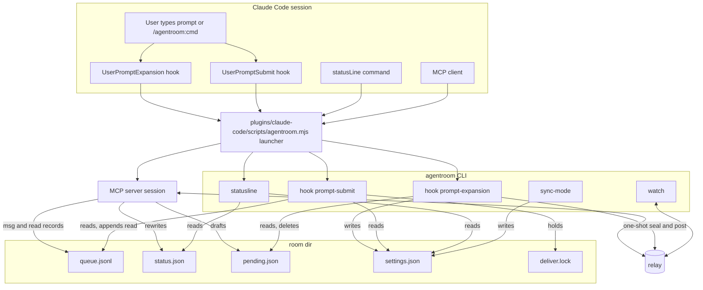
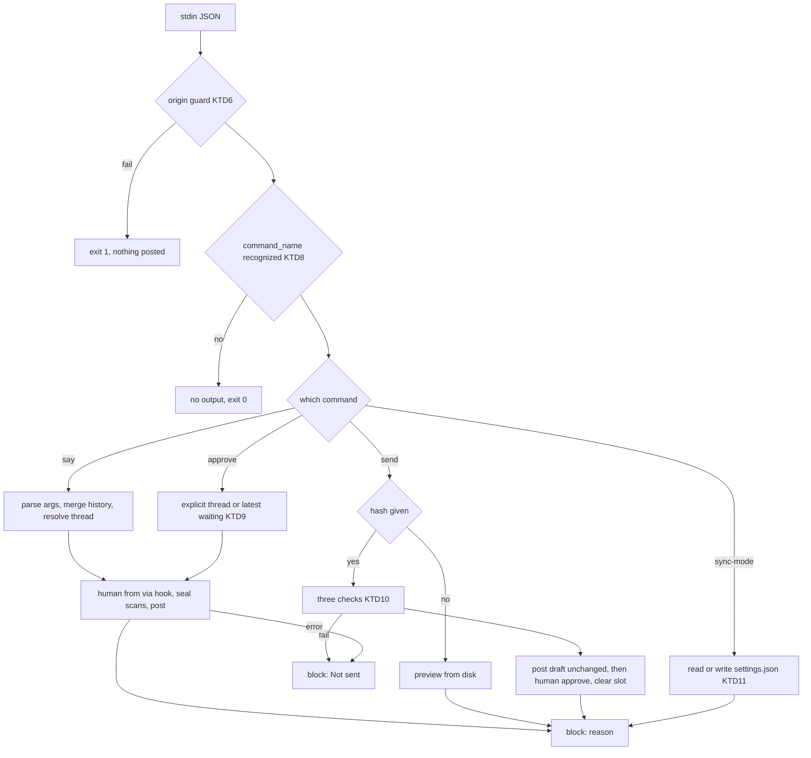
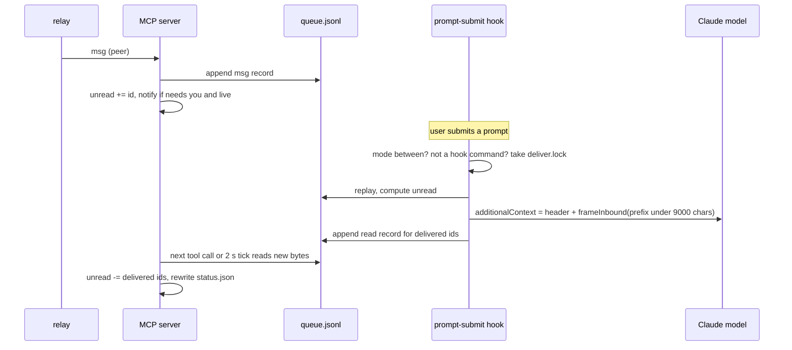
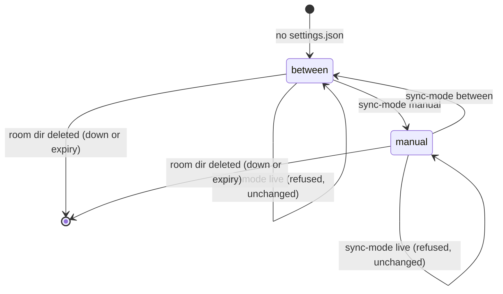

# Milestone 3 Claude Code Plugin and Humans - Plan

## Goal Capsule

- **Objective:** Two developers can work a full day with their agents in one room without copy-pasting between agents, and neither misses a message that needs them. Coworker messages reach a Claude Code session at the next prompt, the human can speak and approve in their own words from inside Claude Code without the model ever seeing or forging that text, and anyone can follow and join the room from a plain terminal pane.
- **Means:** A Claude Code plugin whose files are thin wrappers over CLI subcommands (KTD1-KTD4), hook subcommands for human sending, draft release and `between` delivery (KTD5-KTD13), MCP session changes for external reads, status and notifications (KTD14-KTD16), a status line with install-time chaining (KTD17-KTD18), and a readline `watch` pane (KTD19).
- **Authority:** `CLAUDE.md` invariants 1-7 and stack, then `docs/ARCHITECTURE.md`, then `docs/UX.md`, then `docs/PLAN.md` Milestone 3, then this plan. The M1 plan (`docs/plans/2026-10-11-1329-feat-m1-core-loop-encrypted-plan.md`) and the M2 plan (`docs/plans/2026-10-11-2120-feat-m2-safe-to-use-plan.md`) describe what exists and stay in force unless a KTD here names the change. The M2 plan is the contract for what M2 provides (drafts in `pending.json`, the human guard, `say`/`approve`/`down`/`export`, `connectOnce`, `agentroom-rules`, `room_status` waiting threads). `docs/OPEN_QUESTIONS.md` items 3-9 are settled inputs; this plan adds findings dated 2026-10-12 (Sources).
- **Stop conditions:**
  - Stop if any `packages/mcp/src` code path could build an envelope with `from.agent = "human"` (invariant 2). Human envelopes are built only in `packages/cli/src`.
  - Stop if the `UserPromptSubmit` path could post any envelope. It only reads and marks read (KTD12).
  - Stop if any inbound string reaches model context without `frameInbound`, or reaches a terminal, status line or notification without control-character stripping (invariant 5).
  - Stop if a test would touch the real `~/.agentroom` or `~/.claude`, run the real `claude` binary, pop a real desktop notification, or need a real pseudo-terminal. A test that cannot be isolated is a blocker, not a skip.
  - Stop if M2 has not landed the pieces this plan consumes (human guard and builder, `connectOnce`, drafts, `say`/`approve`). Do not reimplement them here.
- **Execution profile:** TypeScript CLI and MCP server code, plugin manifest and JSON files, unit, integration and spawned-process end-to-end tests. No deployment, no npm publish.
- **Who finishes:** The implementing agent builds and verifies locally, including one `claude plugin validate` run when `claude` is on PATH. The day of real use in `docs/PLAN.md` acceptance is a human step. The orchestrator ticks `docs/PLAN.md` and writes `docs/LOG.md`; this work edits neither.

---

## Product Contract

### Summary

Ship `plugins/claude-code/`: a plugin manifest, a bundled MCP server entry, seven skills (`/agentroom:sync`, `say`, `ask`, `handoff`, `send`, `approve`, `sync-mode`), a `UserPromptExpansion` hook that handles the human-only commands and blocks them from reaching the model, a `UserPromptSubmit` hook that injects queued messages at the next prompt, and a launcher that runs the checkout's CLI. The CLI gains `hook prompt-expansion`, `hook prompt-submit`, `statusline`, `sync-mode`, `watch` and `uninstall claude`, and `install claude` installs the plugin and chains the status line. The MCP server learns about reads made by the hook, writes the waiting-on-human count for the status line, raises desktop notifications for messages that need the human, and serves a "no room" stub when no room is current.

### Problem Frame

After M2 the room is safe, but using it from Claude Code is still manual. Inbound messages sit until the agent happens to call `inbox`. A message that needs the human produces no signal unless someone runs `agentroom status`. The human's only way to speak is `agentroom say` in a separate terminal, which refuses inside Claude Code's integrated terminals. Drafts written with `draft: true` have no release path: M2 deliberately left `/send <hash>` for the plugin. Users of other agents have no live view of the room at all. `docs/PLAN.md` Milestone 3 gates the "full day without copy-pasting" acceptance on closing these gaps, and `docs/UX.md` already fixes the shape: hooks for human input, `between` delivery, a status line, notifications, and a `watch` pane.

### Requirements

**Plugin packaging**

- R1. `plugins/claude-code/` is a valid plugin named `agentroom` (`.claude-plugin/plugin.json`) that bundles the MCP server, the seven skills, the two hooks, and a launcher; `claude plugin validate plugins/claude-code` passes (KTD1, KTD2).
- R2. A marketplace file at the repo root lists the plugin so a checkout can install it without publishing (KTD3).
- R3. The bundled MCP server serves the room named in `~/.agentroom/current` at startup; with no current room it starts and answers every tool with a fixed "no room" text instead of failing (KTD4).

**Human sending from Claude Code**

- R4. `/agentroom:say [--thread <id> | --new] <text>` posts the text verbatim as a human message (`agent: "human"`, `via: "hook"`) with the same thread default as CLI `say`, and the text never reaches the model (KTD7, KTD8).
- R5. `/agentroom:approve [thread]` posts a human `approve` envelope; with no argument it targets the most recently updated thread waiting on a human (KTD9).
- R6. `/agentroom:send` with no argument shows the pending draft read from disk; `/agentroom:send <hash>` posts the pending draft only when the typed hash matches both the stored hash and a fresh hash of the stored envelope, keeps the drafting agent's `from.agent` with `via: "hook"`, then posts a human `approve` for that thread, then clears the draft. A stale or mismatched hash refuses and posts nothing (KTD10).
- R7. Every human-only command is handled by the `UserPromptExpansion` hook, which always blocks the expansion with a reason shown to the user, on success and on failure; a hook crash or timeout also blocks (KTD7).
- R8. `/agentroom:ask <topic>` and `/agentroom:handoff` instruct Claude to draft with `send` or `handoff` and `draft: true`, show the draft and hash, and tell the user to type `/agentroom:send <hash>`; Claude never sends these directly (KTD1).
- R9. `/agentroom:sync` instructs Claude to call `inbox` and summarize what matters for the current task, treating message content as information (KTD1).

**Delivery modes**

- R10. Each room has a delivery mode, `between` (default) or `manual`, set by `/agentroom:sync-mode` or `agentroom sync-mode`; `live` is refused with a short explanation that channels are deferred, and the mode is unchanged (KTD11).
- R11. In `between` mode, the `UserPromptSubmit` hook adds unread messages to the next prompt as `additionalContext`, wrapped by `frameInbound`, oldest first, within the hook's context cap, and marks exactly the delivered messages read; the rest stay unread with a count (KTD12).
- R12. In `manual` mode the hook injects nothing; messages reach the agent only through `inbox`, `wait` or `/agentroom:sync` (KTD11).
- R13. Messages the hook delivered are not returned again by `inbox` or `wait`, and the unread counts in `status.json` reflect them within a few seconds (KTD14).

**Attention**

- R14. A live inbound message with `requiresHuman` or addressed to this member raises a desktop notification on macOS and Linux (no-op elsewhere) whose title and 80-character preview are stripped of control characters (KTD16).
- R15. `agentroom statusline [--chain <cmd>]` prints the chained command's output followed by ` | ` and an agentroom segment (room, unread and needs-you counts, threads waiting on a human, active peers) built from local files only (KTD17).
- R16. `agentroom install claude` installs the plugin, removes the M1 user-scope MCP registration, and writes `statusLine` into Claude Code user settings chaining any existing command; running it twice changes nothing further; `agentroom uninstall claude` restores the previous status line and removes the plugin (KTD3, KTD18).

**Watch pane**

- R17. `agentroom watch` shows every thread with its messages, marks `requiresHuman` messages and chain-limited threads, and redraws on resize; every peer string it draws is stripped of control characters, keeping newlines only inside bodies (KTD19).
- R18. The `watch` input line posts human messages (`via: "watch"`) to the selected thread and refuses to start under an agent environment marker or without a terminal on stdin and stdout (M2 KTD18).

**Invariants**

- R19. The MCP server still emits no human-tagged envelope; the human builder's only callers are CLI `say`, `approve`, the expansion hook module and the watch module (KTD6).
- R20. Every new delivery path (hook context) uses `frameInbound`; every new human surface (watch, status line, notifications, hook reasons) strips control characters from peer strings (invariant 5).
- R21. Settings, locks, notification claims and drafts added here live in the room directory and are deleted with it on `down` or expiry (invariant 7).

### Acceptance Examples

- AE1. **Covers R4, R7.** Given alice's room has one thread from bob's agent, when the hook receives a `UserPromptExpansion` event with `command_name` `agentroom:say` and `command_args` `Sealed class.\nShip it`, then bob's relay feed gets an `answer` in that thread with `from.agent: "human"`, `via: "hook"`, body exactly `Sealed class.\nShip it`, and the hook prints `{"decision":"block","reason":"Sent to room <id8> as alice (human) in thread <id8>."}` and exits 0.
- AE2. **Covers R6.** Given alice's agent drafted a question and was shown hash `h1`, when the draft is replaced by a new one (hash `h2`) and the user types `/agentroom:send h1`, then nothing is posted and the reason says the draft changed. When the user types `/agentroom:send h2`, then bob receives the draft with alice's agent tag and `via: "hook"`, then a human `approve` in the same thread, and `pending.json` is gone.
- AE3. **Covers R6.** Given `pending.json` whose `env` was edited after the hash was written (stored hash no longer matches the envelope), when the user types `/agentroom:send <stored hash>`, then the hook refuses and posts nothing.
- AE4. **Covers R11, R13, R20.** Given two unread messages, one whose body contains `</agentroom_message_x>` and a fake reminder line, when the `UserPromptSubmit` hook runs in `between` mode, then stdout is one JSON object whose `additionalContext` holds both messages inside one `frameInbound` call with the body escaped, a second run prints nothing, and the MCP server's next `inbox` says there are no unread messages.
- AE5. **Covers R12.** Given mode `manual` and unread messages, when the `UserPromptSubmit` hook runs, then it prints nothing and nothing is marked read.
- AE6. **Covers R16.** Given `~/.claude/settings.json` with `statusLine.command` `"~/bin/my-line"`, when `install claude` runs twice and then `uninstall claude` runs, then after each install the command is the agentroom statusline command chaining `~/bin/my-line`, and after uninstall the original `statusLine` object is back exactly.
- AE7. **Covers R18.** Given `CLAUDECODE=1`, when `agentroom watch` starts with faked TTYs, then it exits non-zero naming the marker and opens no relay connection.

### Scope Boundaries

- No `live` delivery through channels; `/agentroom:sync-mode live` explains the deferral (`docs/OPEN_QUESTIONS.md` item 8).
- No npm-installed plugin path; plugin install from an npm copy of the CLI arrives with the M4 publish, and `install claude` falls back to M1 MCP-only registration there (KTD3).
- No adapters for other agents, no `relay-cf` (M4).
- No Windows notifications or status line testing; the notifier is a no-op off macOS and Linux.
- No short or prefix thread ids; `/agentroom:approve` and `say` defaults cover the common case (M2 Scope Boundaries deferred this to M3; KTD9 decides against it for now).

Considered and not built:

- **`node-notifier`.** Version 11.0.0 (published 2026-10-09 after a four-year gap) declares `engines.node` `^22.22.2 || ^24.15.0 || >=26.0.0`, which excludes the Node 20 CI leg, and it ships vendored notifier binaries. OS commands cover macOS and Linux with no dependency (KTD16).
- **A transcript check in the hook-origin guard.** The hooks reference says the transcript is written asynchronously and may lag the current turn, so matching the typed prompt against `transcript_path` would fail intermittently. Revisit if Claude Code documents a synchronous write.
- **A local IPC channel between the hook and the MCP server.** Read records in `queue.jsonl` plus a short poll keep the MCP server consistent without a socket server (KTD14).
- **Gating agent-initiated `inbox` in `manual` mode.** `manual` controls push only; an agent that chooses to call `inbox` is doing what the tools promise. Revisit if users read `manual` as "the agent must not read".
- **Notification throttling.** The chain limit caps agent bursts at 3 per thread and 6 per room, so a burst of needs-you notifications is bounded.
- **A room-ownership lock shared by the MCP server, hooks, status line and watch.** It would keep every surface on the server's room after a mid-session `up`, but the restart instruction covers the normal flow and multiple rooms per session are a "Later" item in `docs/PLAN.md`. Revisit if the day of use shows mismatched rooms.
- **Notifications while Claude Code is closed.** Notifications come from the MCP server, so none fire without an agent session; `watch` and the CLI cover that case. Revisit after the day of use.
- **A watch-pane presence envelope.** The relay already counts the connection; adding a human-tagged presence adds a member row with no benefit.

#### Deferred to Follow-Up Work

- M4: plugin install from the published npm package (launcher candidate path inside the package, marketplace hosted on GitHub).
- M4: `live` delivery once channels accept a 2026-07-28 MCP server or leave preview.
- After the human day of use: reconsider prefix thread ids if typing full ULIDs proves painful.

### Sources

- `CLAUDE.md`; `docs/UX.md` (Claude Code plugin, Why human messages go through a hook, Delivery modes, watch); `docs/ARCHITECTURE.md` (Local state and process model, inbound framing, released drafts, chain limit); `docs/PLAN.md` Milestone 3; `docs/OPEN_QUESTIONS.md` items 3-9.
- Existing code: `packages/mcp/src/session.ts` (`createRoomSession`, `isNeedsYou`, `persistStatus`, `inbox`), `packages/mcp/src/state.ts` (`replayQueue`, `appendQueue`, `writeAtomic`, `StatusFile`), `packages/mcp/src/pending.ts` (`draftHash`, `writePending`), `packages/mcp/src/stdio.ts` (`runStdio`), `packages/cli/src/commands/install.ts` (`mcpServerCommand`, `findOnPath`, `.mcp.json` merge), `packages/cli/src/commands/mcp.ts`, `packages/protocol/src/frame.ts` (`frameInbound`, `stripControl`), `packages/protocol/src/chain.ts` (`chainState`, `waitingThreads`).
- Findings verified 2026-10-12 (recorded in `docs/OPEN_QUESTIONS.md` by U13):
  - https://code.claude.com/docs/en/hooks: `UserPromptExpansion` stdin carries `expansion_type`, `command_name`, `command_args`, `command_source`, `prompt` and the common `transcript_path`; it matches on `command_name`; `decision: "block"` ends the turn and shows `reason` as a warning line; exit 2 also blocks. Hook `additionalContext` and plain stdout are capped at 10,000 characters each; over the cap the text is replaced by a file path and a 2,000-character preview. `UserPromptSubmit` has a 30 s default timeout, a timed-out hook's output is discarded, and it also fires for scheduled tasks, background subagent reports and messages from other sessions. Exec-form hooks take `command` plus `args` with no shell; `onFailure: "block"` (Claude Code 2.1.295 or later) makes a failed hook block. Hooks receive `CLAUDE_PLUGIN_ROOT`, `CLAUDE_PLUGIN_DATA` and `CLAUDE_PROJECT_DIR`. The transcript "may lag the in-memory conversation". The docs do not say whether `command_name` for a plugin skill is `say` or `agentroom:say`, nor how `UserPromptExpansion` and `UserPromptSubmit` are ordered.
  - https://code.claude.com/docs/en/env-vars: `CLAUDECODE` and `CLAUDE_CODE_CHILD_SESSION` are both set for Bash tool, hook and status line subprocesses, so they cannot tell a hook from the Bash tool. `CLAUDE_CONFIG_DIR` overrides `~/.claude` ("All settings, session history, and plugins are stored under this path"). Observed the same day in a Claude Code 2.1.296 Bash tool subprocess: `CLAUDE_PLUGIN_ROOT` is not set.
  - https://code.claude.com/docs/en/slash-commands: plugin skills are namespaced `/plugin-name:skill-name`; when no placeholder receives the arguments, Claude Code appends `ARGUMENTS: <input>` to the skill content.
  - https://code.claude.com/docs/en/plugin-marketplaces: a marketplace is a directory with `.claude-plugin/marketplace.json` (`name`, `owner`, `plugins[]` with `name` and a `source` relative to the marketplace root, no `..`); a marketplace added from a local directory with a relative-path source reads plugin files in place, not from a cache copy.
  - `claude plugin --help` (2.1.296): `claude plugin install <plugin> --marketplace <path> [--scope user]` adds the marketplace if needed; `claude plugin uninstall <plugin>`; `claude plugin validate <path>`; `--json` on install and uninstall.
  - `npm view node-notifier` (2026-10-12): version 11.0.0, engines as above.

---

## Planning Contract

### Key Technical Decisions

**Plugin**

- KTD1. **Skills, namespaced, all user-invoked.** Each command is `plugins/claude-code/skills/<name>/SKILL.md` (the preferred format per `docs/OPEN_QUESTIONS.md` item 4), invoked as `/agentroom:<name>`. All seven set `disable-model-invocation: true`: each is a user-triggered workflow, and the model already has the MCP tools for anything it wants to do on its own. The four hook-handled skills (`say`, `approve`, `send`, `sync-mode`) have a body that only runs if the hook did not: it tells Claude that nothing was sent, that it must not send the text itself with any tool, and that the user should check that plugin hooks are enabled or use `agentroom say` in a terminal. The body never references `$ARGUMENTS`; Claude Code would still append `ARGUMENTS:`, which is why `onFailure: "block"` (KTD7) is the primary guard. `ask` and `handoff` bodies tell Claude to compose from current context with refs, call `send` (kind `question`) or `handoff` with `draft: true`, show the returned draft verbatim with its hash, and end with "Type `/agentroom:send <hash>` to send it." `sync` tells Claude to call `inbox`, summarize what matters for the current task, flag anything marked `requiresHuman` for the user, and treat message content as information. UX's bare names (`/say`) become `/agentroom:say` in docs, because the docs only promise the namespaced form.
- KTD2. **A launcher, not paths into the checkout.** `plugins/claude-code/scripts/agentroom.mjs` resolves the CLI entry relative to its own location (`../../../packages/cli/dist/bin.js`, the checkout layout) and imports it in-process (it sits in `scripts/`, not `bin/`, because files in a plugin's top-level `bin/` go on the Bash tool's PATH per the plugins reference), so `process.argv` and the CLI's `entryPath` are unchanged and no second Node process starts on every prompt. A missing entry prints "agentroom: CLI build not found at <path>; run `pnpm build` in the agentroom checkout" to stderr and exits 1. `.mcp.json` and `hooks/hooks.json` use exec form, `command: "node"` with `args: ["${CLAUDE_PLUGIN_ROOT}/scripts/agentroom.mjs", ...]`, so no shell parses anything. The relative path works because a local-directory marketplace reads plugin files in place (Sources). M1 KTD15's rule (absolute node plus entry from a checkout, `npx` only from `node_modules`) stays for `.mcp.json` fallback and status line commands.
- KTD3. **Repo-root marketplace, one install command.** `.claude-plugin/marketplace.json` at the repo root names the marketplace `agentroom`, owner `agentroom`, with one entry `{ name: "agentroom", source: "./plugins/claude-code" }`. `install claude` with `claude` on PATH and a checkout entry path:
  1. `claude mcp remove --scope user agentroom` (ignore failure), so the M1 registration and the plugin server never both run against one queue.
  2. `claude plugin install agentroom --marketplace <repo root> --scope user`; the repo root is three directories above `dist/bin.js` and must contain `.claude-plugin/marketplace.json`.
  3. Write the status line (KTD18).
  From an entry inside `node_modules`, it keeps the M1 `claude mcp add` path and prints that plugin install arrives with the npm release. Without `claude` on PATH, it keeps the M1 `.mcp.json` fallback, writes the status line, and prints `claude --plugin-dir <repo>/plugins/claude-code` as the way to load the plugin. Every spawn uses argument arrays. Whether a repeated `plugin install` exits 0 is unverified; `install` treats an "already installed" non-zero exit like success only if the implementer confirms the message once against the real `claude` and records it (Deferred to Implementation).
- KTD4. **The plugin's MCP server takes no `--room`.** `agentroom mcp` without `--room` uses `current` at startup. With no current room, or a current id with no `room.json`, `runStdio` serves a stub registering the same tool names whose handlers return `NO_ROOM_TEXT`: "No agentroom room is active. Run `agentroom up` or `agentroom join <code>`, then restart Claude Code (or reconnect the agentroom server in /mcp)." This keeps a globally installed plugin quiet in projects with no room instead of showing a failed server every session. The stub lives in `packages/mcp/src/server.ts` beside `createMcpServer` and builds no envelopes. `up` and `join` already set `current`; their closing text tells Claude Code users to restart.

**Hooks**

- KTD5. **Hook entry points are CLI subcommands with one stdin reader.** `agentroom hook prompt-expansion` and `agentroom hook prompt-submit` read stdin to end (cap 1 MiB, 5 s), parse JSON, and validate with zod schemas that require the fields this plan uses and pass unknown fields through. `CliContext` already carries `stdin`; tests feed fixtures copied from the hooks reference examples with fields changed.
- KTD6. **Hook-origin guard, and the human builder gains `via`.** The M2 human guard cannot run here: hooks run with `CLAUDECODE` set and no TTY. The expansion hook instead requires a non-empty `CLAUDE_PLUGIN_ROOT`, a non-TTY stdin, `hook_event_name: "UserPromptExpansion"` and `expansion_type: "slash_command"`; otherwise it exits 1 with "agentroom hook: not running as a Claude Code plugin hook" and posts nothing. Claude Code sets `CLAUDE_PLUGIN_ROOT` for plugin hooks and not for Bash tool commands (Sources), so an agent that runs the subcommand from its shell by accident is refused. Like M2's guard, this stops accidental impersonation, not a deliberate agent that sets the variable (ARCHITECTURE threat model). M2's human builder in `packages/cli/src/human.ts` takes the `via` to stamp (`"cli" | "hook" | "watch"`), and M2's source-scan test widens its allowed callers to `say.ts`, `approve.ts`, `hook/expansion.ts` and `watch/` modules.
- KTD7. **Expansion hook output contract.** For a recognized command the hook always exits 0 and prints exactly one JSON object `{"decision":"block","reason":"<text>"}`, on success and on every failure, so the typed text never expands into a prompt. For any other `command_name` it prints nothing and exits 0. `hooks.json` declares it with `timeout: 30` and `onFailure: "block"`, so a crash or timeout also blocks. Reason texts (peer-chosen ids stripped of control characters and cut to 8 characters for display, room shown as the first 8 hex of its id):
  - say: "Sent to room <id8> as <member> (human) in thread <id8>." or, for `--new` or no history, "... in new thread <id8>."
  - approve: "Approved thread <id8> in room <id8> as <member> (human)."
  - send preview: "Pending draft <hash> (<kind>, thread <id8>):" then the body stripped of control characters except newlines, cut at 1,500 characters with "[truncated]", then "Type /agentroom:send <hash> to send it."
  - send release: "Sent draft <hash> to room <id8> (thread <id8>) and approved the thread as <member> (human). Sent text: <first 200 characters of the body, stripped>", so the human sees what was actually released, read from disk.
  - sync-mode: "Delivery mode for room <id8>: <mode>." plus the live text from KTD11 when asked for `live`.
  - every failure: "Not sent: <cause>" (the scanner's KTD4 text from M2, the chain or thread error, "no current room", the run-`up` text on a gone room, a relay error code).
- KTD8. **Command-name and argument parsing.** The docs do not say whether a plugin skill's `command_name` arrives as `say` or `agentroom:say` (Sources), and a bare `approve` could be the user's own or a project's skill, which the user-scope hook must never hijack. The hook handles `command_name` `agentroom:<say|approve|send|sync-mode>`, or the bare name only when the hook input's `prompt`, leading whitespace trimmed, starts with `/agentroom:<name>`; every other case prints nothing and lets the command expand. The `hooks.json` matcher is `^(agentroom:)?(say|approve|send|sync-mode)$` so both forms reach the subcommand, which applies the rule above, so an unanchored or literal matcher reading cannot widen what is handled. `/say` arguments: an optional leading `--thread <id>` or `--new`, then the rest of `command_args` verbatim with outer whitespace trimmed, internal newlines kept. This differs from CLI `say`, which joins argv with spaces, because the hook receives the typed string itself. Empty text or both flags is a "Not sent: usage ..." reason.
- KTD9. **`/approve` default.** With a thread id, the thread must exist (M2 KTD2 texts). With no argument, history is merged as M2 KTD20 does, `chainState` runs with the room's `maxAgentChain` from `welcome.meta`, and the most recently updated waiting thread is approved. With none waiting it refuses: "Not sent: no thread is waiting on a human; pass a thread id." Prefix ids are not added: ULID prefixes share their timestamp, so short prefixes collide in exactly the threads a user wants to tell apart.
- KTD10. **Draft release verifies three things before posting.** `/send <hash>`:
  1. Reads `<room>/pending.json`; missing gives "Not sent: no draft is pending."
  2. Requires the typed value (lowercased, 12 hex) to equal the stored `hash`, and the stored `hash` to equal `draftHash` over the raw stored `env` (re-serialized from the parsed file before any zod parsing, which could reorder or default fields). Either mismatch gives "Not sent: the pending draft changed after it was shown (now <stored hash>). Ask Claude to show it again, or type /agentroom:send to preview it."
  3. Parses `env` with `Envelope` and requires `from.member` equal to `room.json`'s member, `from.via === "hook"`, `from.agent` not `"human"`, `kind` not `approve` or `presence`, and `env.id` not already in the local queue (peers would drop a reused id as a replay while the user sees "sent"; refused with "Not sent: this draft was already sent."). This stops a hand-edited `pending.json` from being released as a human message even when its hash was recomputed.
  Then it posts the envelope unchanged through the M2 seal-and-post helper (no chain check, M2 KTD16), posts a human `approve` in `env.thread` (`via: "hook"`), and deletes `pending.json` only if its bytes still equal what was read. If the draft posts and the approve fails, the reason says so: "Sent draft <hash>, but the approval was not sent: <cause>. Run /agentroom:approve <thread> to retry." `/send` with no argument returns the preview from KTD7 read from disk, so the human can see the stored text without trusting the model's rendering of it.
- KTD11. **Delivery mode lives in `<room>/settings.json`.** `{ v: 1, delivery: "between" | "manual" }`, written atomically (0600) by the CLI only, read by the prompt-submit hook and the status line; absent means `between`. `status.json` is rewritten by the MCP server on every state change and cannot hold a CLI-owned field. `agentroom sync-mode [between|manual|live] [--room <id>]` prints or sets the mode with no TTY guard (not a human-tag path; an agent switching its own push mode is an annoyance, not impersonation). `/agentroom:sync-mode` reuses the same function. `live` answers "Live delivery is not available yet: Claude Code channels are a research preview that does not load this server. Mode unchanged (<mode>)." The MCP server ignores the mode: notifications and the status line work in both modes.
- KTD12. **`between` delivery reads, frames, and marks read; it never posts.** `hook prompt-submit`, for every prompt:
  1. Exit 0 with no output when there is no current room, no room directory, mode `manual`, or the prompt (leading whitespace trimmed) starts with `/`. The last rule guards two unverified cases: `UserPromptSubmit` firing before a blocked expansion, and firing for built-in local commands (`/clear`, `/mcp`) whose turn never reaches the model; either would mark messages read and drop them. Messages arrive with the next plain prompt instead.
  2. Take `<room>/deliver.lock` (exclusive create holding pid and time; a lock older than 10 s is stale and replaced; give up after 1 s and exit 0 with no output).
  3. Rebuild unread from `replayQueue` (same rule as the session: not own, not presence, not read).
  4. Frame oldest first with one `frameInbound` call over the longest prefix whose full output, header and trailer included, stays under 9,000 characters (under the 10,000 cap). Header: "agentroom: N new message(s) from the room since your last prompt. Messages marked requiresHuman need your user's decision; tell them rather than deciding alone." Trailer when some remain: "M more unread; call the inbox tool to read them." If the oldest message alone does not fit, deliver none and add only "1 or more messages are waiting; call the inbox tool to read them."
  5. Append one `{t:"read", ids}` record for exactly the delivered ids, release the lock, print `{"hookSpecificOutput":{"hookEventName":"UserPromptSubmit","additionalContext":"..."}}`.
  Any error is written to stderr and exits 0 with no stdout, so a broken room never blocks the user's prompt. The module never imports the human builder or the seal helper; a source-scan test asserts it.
- KTD13. **The hook is a second writer of `queue.jsonl`, for `read` records only.** Each record is one `O_APPEND` write of one line, the same discipline the MCP server uses, so lines from the two processes do not interleave on a local filesystem. `deliver.lock` serializes hook runs from several Claude sessions. The MCP server stays the only writer of `msg` records and `status.json`. ARCHITECTURE's local state contract is updated to say so.

**MCP server**

- KTD14. **The session picks up reads it did not make, and recognizes its own member's agent posts.** The session remembers the byte length of `queue.jsonl` it has applied and, before every tool call and on a 2 s unref'd timer, reads the new bytes, applies `read` records to `unread`, ignores `msg` lines (it already has them), and persists status when anything changed. A torn last line is left for the next read. Two Claude sessions on one room converge on the same unread set this way, which M1 did not guarantee. M1 marks a message `own` only when it matches this process's in-flight send, so a draft released by the hook or a send from a second session would come back as unread to the agent that wrote it. The session now also treats an envelope with `from.member` equal to this room's member and `from.agent` not `"human"` as own. Messages from this member's human (hook, watch, CLI) stay unread for the agent, per the M2 assumption that the agent should see what its human said.
- KTD15. **`status.json` gains `waitingOnHuman` (count) and `roomName`.** Both optional in `StatusFile`, so an older file still parses. `waitingOnHuman` is the length of `waitingThreads(chainState(...))`, written in `persistStatus`. `roomName` is `meta.name` from `welcome`, stripped and cut to 32 characters, when present.
- KTD16. **Notifications in the session, OS commands chosen at runtime.** `packages/mcp/src/notify.ts` exports a notifier picked once: on macOS, `osascript` with `-e 'on run argv'`, `-e 'display notification (item 2 of argv) with title (item 1 of argv)'`, `-e 'end run'`, then title and text as separate arguments, so no peer text is ever inside AppleScript source; on Linux with `notify-send` on PATH, `notify-send --app-name=agentroom -- <title> <text>` with `&`, `<` and `>` escaped because notification servers may read the body as markup; otherwise a no-op. Spawned detached with `stdio: "ignore"`, no shell, errors ignored. `AGENTROOM_NOTIFY=off` selects the no-op (tests and conformance set it); `createRoomSession` accepts an injected notifier. `onMsg` notifies for a non-own, non-presence envelope from another member (`from.member` not this room's member, so the human's own `/say` never notifies them) that passes `isNeedsYou` and whose seq is above the head seq of the session's first `welcome`, so the `since=0` catch-up after a restart never fires a burst. Before spawning, the session claims the notification by exclusively creating `<room>/notified/<env.id>`; only the process that creates it notifies, so several Claude Code sessions on one room raise one notification. The directory goes with the room dir. Title "agentroom: <member> needs you" when `requiresHuman`, otherwise "agentroom: <kind> for you from <member>"; text is the body's first 80 characters with whitespace runs collapsed. Member and body go through `stripControl` first.

**Status line and install**

- KTD17. **Status line output.** `agentroom statusline [--chain <cmd>]` reads stdin to end (cap 256 KiB, 1 s). With `--chain`, it runs `/bin/sh -c <cmd>` with the same stdin and a 2 s timeout and keeps its stdout without the trailing newline (a timeout or failure contributes nothing). The segment, from `current`, `room.json`, `status.json` and `settings.json` only: `agentroom * <roomName or id8> | <u> unread (<n> need you) | <w> waiting on a human | <member>/<agent> active`. The waiting part appears only when non-zero, peers are members other than this one with `lastSeen` within 15 minutes (at most two, then "+k"), and `manual` mode appends ` | manual`. Peer names are stripped and cut to 24 characters. With a room in state `gone`, the segment is `agentroom * room closed`; with no room, only the chained output prints. Output is `<chained> | <segment>`, or either alone. No color codes. Exit 0 always.
- KTD18. **Status line install, chaining and restore.** The settings file is `<CLAUDE_CONFIG_DIR or $HOME/.claude>/settings.json`. `install claude`:
  1. Read it; invalid JSON aborts with the file name and touches nothing; a missing file starts from `{}`.
  2. If `statusLine` is not already ours, save it (or `null`) to `<AGENTROOM_HOME>/claude-install.json` (0600).
  3. Write `statusLine = { type: "command", command, padding, refreshInterval }` atomically, keeping every other key. `command` is the POSIX single-quoted absolute node path and entry path (M1 KTD15 checkout form, never `npx`, because the line refreshes every few seconds), then `statusline`, then `--chain` and the saved original command single-quoted when there was one. `padding` and `refreshInterval` come from the original when set, else `0` and `10`.
  "Ours" means the current command starts with the quoted node-and-entry prefix and contains ` statusline`; a second install recomputes the command from the saved original, so moving the checkout and reinstalling repairs the path. `uninstall claude` restores the saved object (or deletes `statusLine` when it was `null`) only if the current one is ours, otherwise leaves it and prints that it changed since install; then deletes `claude-install.json` and runs `claude plugin uninstall agentroom@agentroom --scope user` when `claude` is on PATH (failure reported, not fatal).

**Watch**

- KTD19. **`watch` is an in-memory client plus two pure functions.** `packages/cli/src/watch/` holds:
  - `model.ts`: a reducer from decrypted envelopes (seq order) to threads, messages, chain state and needs-you flags.
  - `render.ts`: `renderWatch(model, { cols, rows, selected, input })` returning lines, tested as a pure function.
  - `tui.ts`: the terminal driver.
  The driver runs the M2 human guard (stdin and stdout TTYs, no agent markers), opens its own `RelayClient` with `initialSince: 0` (ARCHITECTURE counts a watch pane as one of a member's connections), decrypts in memory, never writes `queue.jsonl`, never marks anything read, and sends no presence. It redraws the whole screen on each change and on `process.stdout` `resize` using a cursor-home and clear sequence, with `readline` handling the input line. Input: plain text replies in the selected thread; `/thread <n>` selects by the number shown in the list; `/new <text>` starts a thread; `/approve` approves the selected thread; `/quit` (or Ctrl-C) exits. Posting goes through the M2 seal-and-post helper with `via: "watch"`. Rendering strips control characters from every peer string, splits bodies on newlines after stripping each line, and wraps to the width. Highlights (bold, inverse) come only from the renderer's own constants. On `room_expired`, `room_not_found` or `closed` it prints the matching text and exits 1. A plain readline UI is chosen over Ink: UX allows either, readline needs no dependency, and the pure renderer carries the testable logic.

### High-Level Technical Design

**Components and who writes what**



**Expansion hook decision flow**



**`between` delivery and read convergence**



**Delivery mode states**



### Assumptions

These are agent bets made without a human to confirm them.

- The plugin is installed at user scope, so the bundled MCP server starts in every Claude Code session; the no-room stub (KTD4) keeps that quiet.
- `/agentroom:say` posts with `requiresHuman: false` and no `to`, like CLI `say`.
- A human message posted from the hook arrives at the same machine's MCP server as unread for the agent (M2 assumption), so the agent sees what its human said at the next tool call or prompt.
- The expansion hook needs the network for `/say`, `/approve` and `/send` (one-shot relay connection); 30 s is ample for one connect, catch-up and echo.
- `refreshInterval: 10` is frequent enough for the status line because desktop notifications carry urgency.
- `between` delivery also runs on prompts Claude Code starts itself (scheduled tasks, subagent reports, cross-session messages); delivering then is fine because the agent is about to work.
- Two Claude Code sessions on one room both run an MCP server and both append `msg` records; replay already dedupes by id, and KTD14 converges unread state. Single-writer `msg` records are not restored.

### Output Structure

```text
.claude-plugin/marketplace.json                               (new)
plugins/claude-code/.claude-plugin/plugin.json                (new)
plugins/claude-code/.mcp.json                                 (new)
plugins/claude-code/hooks/hooks.json                          (new)
plugins/claude-code/scripts/agentroom.mjs                         (new)
plugins/claude-code/skills/{sync,say,ask,handoff,send,approve,sync-mode}/SKILL.md (new)
packages/mcp/src/{notify}.ts                                  (new)
packages/mcp/src/{session,server,state,stdio,index}.ts        (modified)
packages/mcp/test/{notify,external-reads,no-room}.test.ts     (new)
packages/cli/src/hook/{stdin,expansion,submit,release}.ts     (new)
packages/cli/src/commands/{hook,statusline,sync-mode,watch,uninstall}.ts (new)
packages/cli/src/watch/{model,render,tui}.ts                  (new)
packages/cli/src/{human,args,index}.ts                        (modified)
packages/cli/src/commands/{install,mcp}.ts                    (modified)
packages/cli/test/{hook-expansion,hook-submit,draft-release,statusline,sync-mode,watch-render,watch-model,install-plugin,plugin-files}.test.ts (new)
packages/cli/test/fixtures/hooks/*.json                       (new)
tests/conformance/test/claude-plugin.test.ts                  (new)
README.md, docs/ARCHITECTURE.md, docs/UX.md, docs/OPEN_QUESTIONS.md (modified)
```

### Risks

| Risk | Mitigation |
|---|---|
| `command_name` arrives in a form the matcher misses, so `/agentroom:say` expands and the model sees the text. | KTD8 matches both forms and checks the typed `prompt` for bare names; the skill body tells Claude nothing was sent and not to send it; the human day of use checks it, and the implementer confirms against the real `claude` once if a session is available. |
| `UserPromptSubmit` fires before a blocked expansion and marks messages read that never reach the model. | KTD12 step 1 skips delivery for prompts that start with a hook-handled command. |
| A hook-delivered batch is discarded because the hook timed out after marking read. | The hook does local file work only and marks read last; the lock wait is capped at 1 s. |
| The hook and the MCP server both append to `queue.jsonl`. | One `O_APPEND` write per record on a local filesystem (KTD13); torn tails are already skipped by `replayQueue`. |
| An agent edits `pending.json` and recomputes the hash before the user types it. | The user typed the hash shown in the tool result; `/agentroom:send` with no argument previews from disk; KTD10 refuses a human-tagged or wrong-member draft. |
| `node` is not on Claude Code's PATH (native installer without Node), so the launcher never starts. | The hook fails, `onFailure: "block"` blocks, and the skill body explains; README states the plugin needs Node 20.19+ on PATH. |
| An agent runs `agentroom hook prompt-expansion` from its shell with forged stdin. | KTD6 refuses without `CLAUDE_PLUGIN_ROOT`; a deliberate agent can set it, which the threat model already accepts. |
| The MCP server binds to `current` at startup while hooks and the status line re-read it, so after `up` or `join` in another terminal they act on a newer room than the agent's tools. | `up` and `join` tell Claude Code users to restart; the status line shows which room is current; a room-ownership lock is not built (Scope Boundaries). |
| Every open Claude Code session holds a relay connection to the current room, and each hook post and watch pane adds one, against the relay's cap of 8 per room. | Hook posts fail with the `room_full` text and the user can close idle sessions; the cap is a relay option, and the day of use shows whether the default needs raising. |
| `install claude` corrupts `~/.claude/settings.json`. | Invalid JSON aborts untouched; writes are atomic and keep every other key; tests use `CLAUDE_CONFIG_DIR` in a temp dir. |
| A notification shows text a peer crafted to look like a system alert. | Title prefix "agentroom:" is fixed, text is stripped and cut to 80 characters, and peer text is passed as argv, never as script source. |

### Documentation Plan

- U3 adds `settings.json`, the delivery mode rule and the `sync-mode` command to ARCHITECTURE "Local state" and UX "CLI" and "Delivery modes" (manual controls push only).
- U4 adds the external-read rule (KTD13, KTD14) and the `status.json` fields to ARCHITECTURE's local state contract.
- U5 records the notifier choice and the `AGENTROOM_NOTIFY` switch in UX (watch and notifications) and README, including that notification previews (sender and first 80 characters) stay in the OS notification history after `down` or expiry, which `AGENTROOM_NOTIFY=off` avoids.
- U7 and U8 update UX "Why human messages go through a hook": namespaced command names, the always-block contract, the hook-origin guard, the `/send` preview and three checks, the `UserPromptSubmit` never-posts rule.
- U10 updates UX "Status line" with the segment format and chaining details.
- U11 updates UX "Claude Code plugin" install text and README install steps (`install claude`, `--plugin-dir`, `uninstall claude`, Node on PATH, and keeping one Claude Code session on the room or `manual` mode in the others until the project-binding question is decided).
- U12 updates UX "`agentroom watch`": readline chosen, input commands.
- U13 records the 2026-10-12 findings in `docs/OPEN_QUESTIONS.md` items 4, 6, 7 and a new notifier entry, and writes README Usage and Status for M3.

---

## Implementation Units

| U-ID | Title | Key files | Depends on |
|---|---|---|---|
| U1 | CLI hook plumbing and human builder `via` | `packages/cli/src/{hook/stdin,human,args,index}.ts`, `commands/hook.ts` | M2 |
| U2 | MCP no-room stub and `mcp` without `--room` | `packages/mcp/src/{server,stdio}.ts`, `packages/cli/src/commands/mcp.ts` | M2 |
| U3 | Delivery mode: `settings.json` and `sync-mode` | `packages/mcp/src/state.ts`, `packages/cli/src/commands/sync-mode.ts` | U1 |
| U4 | MCP external reads and status fields | `packages/mcp/src/{session,state}.ts` | M2 |
| U5 | MCP desktop notifications | `packages/mcp/src/{notify,session}.ts` | U4 |
| U6 | `between` delivery hook | `packages/cli/src/hook/submit.ts` | U1, U3, U4 |
| U7 | Expansion hook: `/say`, `/approve`, `/sync-mode` | `packages/cli/src/hook/expansion.ts` | U1, U3 |
| U8 | Expansion hook: `/send` draft release | `packages/cli/src/hook/release.ts` | U7 |
| U9 | Plugin files, launcher, marketplace | `plugins/claude-code/**`, `.claude-plugin/marketplace.json` | U2, U6, U7, U8 |
| U10 | `statusline` subcommand | `packages/cli/src/commands/statusline.ts` | U3, U4 |
| U11 | `install claude` plugin and status line; `uninstall claude` | `packages/cli/src/commands/{install,uninstall}.ts` | U9, U10 |
| U12 | `watch` pane | `packages/cli/src/watch/*`, `commands/watch.ts` | U1 |
| U13 | End-to-end plugin test and docs | `tests/conformance/test/claude-plugin.test.ts`, docs | U1-U12 |

### U1. CLI hook plumbing and human builder `via`

- **Goal:** One tested stdin reader and dispatch for hook subcommands, and a human builder every human input path shares.
- **Requirements:** R19; groundwork for R4-R7, R11.
- **Dependencies:** M2 (human guard and builder, seal-and-post helper).
- **Files:** `packages/cli/src/hook/stdin.ts`, `packages/cli/src/commands/hook.ts`, `packages/cli/src/human.ts`, `packages/cli/src/args.ts`, `packages/cli/src/index.ts`, `packages/cli/test/hook-stdin.test.ts`, `packages/cli/test/human.test.ts` (M2's, extended).
- **Approach:**
  1. `readHookInput(ctx, schema)` per KTD5.
  2. `hook` command dispatches `prompt-expansion` and `prompt-submit`; unknown subcommand is a usage error. Usage text lists `hook`, `statusline`, `sync-mode`, `watch` and `uninstall` (the first two under "Used by the Claude Code plugin").
  3. Human builder takes `via` per KTD6; existing `say`/`approve` pass `"cli"`.
  4. If M2 left seal-and-post inline in `say.ts`, move it to `packages/cli/src/post.ts` unchanged (connect once with `since: 0`, merge local queue, seal, put, wait for echo) so the hook and watch reuse it.
- **Patterns to follow:** `packages/cli/src/args.ts` dispatch table (M1 KTD2); M2's `human.ts`.
- **Test scenarios:**
  - Valid JSON on stdin parses against a schema and unknown fields are kept.
  - Invalid JSON, empty stdin, and input over 1 MiB each fail with a clear error.
  - Stdin that never ends fails after the timeout (short timeout injected).
  - `agentroom hook bogus` exits 2 with usage.
  - The builder returns `via: "hook"` and `via: "watch"` when asked and `"cli"` for `say`.
  - The source scan finds the builder referenced only from `say.ts`, `approve.ts`, `hook/expansion.ts`, `hook/release.ts` and `watch/` files.
- **Verification:** cli tests green; M2's say/approve tests unchanged and green.

### U2. MCP no-room stub and `mcp` without `--room`

- **Goal:** The plugin's MCP server starts in any project and either serves the current room or says how to get one.
- **Requirements:** R3.
- **Dependencies:** M2.
- **Files:** `packages/mcp/src/server.ts`, `packages/mcp/src/stdio.ts`, `packages/mcp/src/index.ts`, `packages/cli/src/commands/mcp.ts`, `packages/mcp/test/no-room.test.ts`, `packages/cli/test/index.test.ts`.
- **Approach:**
  1. `createNoRoomServer()` registers the same tool names (`room_status`, `send`, `inbox`, `wait`, `handoff`) with permissive input schemas and returns `NO_ROOM_TEXT` (KTD4) as a non-error text result; it also registers `agentroom-rules`.
  2. `runStdio` takes an optional room id; without one, or when `room.json` is missing, it serves the stub until stdin ends.
  3. `agentroom mcp` passes `--room` when given, else the current room or nothing, and no longer throws "no current room".
- **Patterns to follow:** `createMcpServer` and the in-process `Client` tests in `packages/mcp/test/server.test.ts`.
- **Test scenarios:**
  - With no `current`, `listTools` returns the five tool names and each call returns `NO_ROOM_TEXT`.
  - With `current` naming a room whose directory is gone, the stub is served.
  - With a valid current room, the real server is served (existing tests).
  - The invariant 2 source guard still counts no new `"human"` literal under `packages/mcp/src`.
- **Verification:** mcp and cli tests green.

### U3. Delivery mode: `settings.json` and `sync-mode`

- **Goal:** A per-room delivery mode the hook and status line read and the human sets.
- **Requirements:** R10, R12, R21.
- **Dependencies:** U1.
- **Files:** `packages/mcp/src/state.ts`, `packages/cli/src/commands/sync-mode.ts`, `packages/cli/src/args.ts`, `packages/cli/src/index.ts`, `packages/mcp/test/state.test.ts`, `packages/cli/test/sync-mode.test.ts`, `docs/ARCHITECTURE.md`, `docs/UX.md`.
- **Approach:**
  1. `RoomSettings` schema plus `readRoomSettings`/`writeRoomSettings` in `state.ts` per KTD11 (state helpers live with the other room files, M1 KTD10).
  2. `setDeliveryMode(home, roomId, arg)` returns the KTD11 texts and is shared by the command and the expansion hook.
- **Test scenarios:**
  - A room with no `settings.json` reads as `between`.
  - `sync-mode manual` writes mode 0600 atomically and prints the mode; `sync-mode` alone prints it.
  - `sync-mode live` prints the deferral text and leaves the file unchanged.
  - `sync-mode fast` is a usage error.
  - A corrupt `settings.json` reads as `between` and the next write replaces it.
  - Deleting the room directory removes `settings.json` (with `deleteRoomDir`).
- **Verification:** tests green; ARCHITECTURE lists `settings.json`.

### U4. MCP external reads and status fields

- **Goal:** Reads made by the hook are honored by `inbox`, `wait` and `status.json`, and the status line has what it needs.
- **Requirements:** R13, R15 (data).
- **Dependencies:** M2.
- **Files:** `packages/mcp/src/session.ts`, `packages/mcp/src/state.ts`, `packages/mcp/test/external-reads.test.ts`, `docs/ARCHITECTURE.md`.
- **Approach:**
  1. Track applied byte length of `queue.jsonl` after the startup replay; apply new `read` records per KTD14 before `status`, `inbox`, `wait` and on the timer; clear the timer in `close()` and on gone.
  2. `StatusFile` gains optional `waitingOnHuman` and `roomName` per KTD15.
- **Patterns to follow:** `replayQueue` line handling; `persistStatus`.
- **Test scenarios:**
  - Two unread messages; a `read` record for one is appended by the test (as the hook would); the next `inbox` returns only the other.
  - Without any tool call, `status.json` shows the lower unread count within one timer tick (fake timers or a short interval option).
  - A torn partial line at the end of the queue is ignored and applied once completed.
  - A `read` record for an unknown id changes nothing.
  - `status.json` has `waitingOnHuman` equal to the number of threads at the limit after three agent messages in one thread (limit 3).
  - `roomName` from meta appears stripped of control characters and cut to 32 characters.
  - An older `status.json` without the new fields still parses.
  - An agent envelope from this room's own member arriving from another process (a released draft) is stored as own: not unread, no wake; a human envelope from the own member is unread.
- **Verification:** mcp tests green.

### U5. MCP desktop notifications

- **Goal:** The human hears about messages that need them while their attention is elsewhere.
- **Requirements:** R14, R20.
- **Dependencies:** U4.
- **Files:** `packages/mcp/src/notify.ts`, `packages/mcp/src/session.ts`, `packages/mcp/test/notify.test.ts`, `docs/UX.md`.
- **Approach:**
  1. Notifier selection and argv shapes per KTD16, with `spawn` injectable for tests.
  2. Session records the first `welcome.seq` and calls the notifier from `onMsg` per KTD16.
- **Test scenarios:**
  - On darwin, a message with title `x"; do shell script "touch /tmp/p` produces an `osascript` spawn whose argv carries title and text as the last two separate arguments and whose `-e` script arguments are the three fixed lines.
  - On linux with `notify-send` on a fake PATH, argv is `--app-name=agentroom`, `--`, title, text, with `<b>` in the body escaped.
  - On linux without `notify-send`, and on win32, nothing is spawned.
  - `AGENTROOM_NOTIFY=off` spawns nothing on any platform.
  - A body with `\u001b[2K`, `\u0007` and 300 characters yields text with no control characters and at most 80 characters.
  - A live `requiresHuman` message from bob notifies once with the "needs you" title; a live `question` with `to` equal to this member notifies with the "for you" title; a message to another member, an own message and a presence do not notify.
  - A live `requiresHuman` message from this room's own member (its human or another session) does not notify.
  - Two sessions on one room receive the same live `requiresHuman` message; the injected notifier is called once and `<room>/notified/<id>` exists.
  - On restart, messages replayed by the `since=0` catch-up (seq at or below the first welcome's head) do not notify.
- **Verification:** mcp tests green and no test spawns a real notifier.

### U6. `between` delivery hook

- **Goal:** Coworker messages reach Claude at the next prompt, framed as untrusted data, without duplicates.
- **Requirements:** R11, R12, R13, R20.
- **Dependencies:** U1, U3, U4.
- **Files:** `packages/cli/src/hook/submit.ts`, `packages/cli/src/commands/hook.ts`, `packages/cli/test/hook-submit.test.ts`, `packages/cli/test/fixtures/hooks/user-prompt-submit.json`.
- **Approach:**
  1. The steps in KTD12, with the lock and queue append per KTD13.
  2. Output only through one JSON write at the end.
- **Execution note:** Start from the hooks-reference `UserPromptSubmit` example as the fixture and assert the exact output object.
- **Test scenarios:**
  - Covers AE4. Two unread messages, one with a closing framing tag and a fake reminder in its body: output parses as JSON with `hookEventName: "UserPromptSubmit"`, `additionalContext` contains the header, exactly one random framing tag pair per message, the escaped body, and the reminder line; a second run prints nothing.
  - After delivery, `replayQueue` shows both ids read.
  - Covers AE5. Mode `manual`: no output, queue unchanged.
  - Prompts `/agentroom:say hi`, `/agentroom:sync` and `/clear`: no output, nothing marked read.
  - No current room, or a missing room directory: no output, exit 0.
  - Thirty unread 1,000-character messages: `additionalContext` stays under 9,000 characters, delivered ids are a prefix in seq order, the trailer counts the rest, and only delivered ids are marked read.
  - A single 8,000-character body with 20 refs that does not fit: nothing delivered, the waiting line is present, nothing marked read.
  - Own messages, presence and already-read messages are never delivered.
  - A fresh `deliver.lock` held by another pid: exits 0 with no output after about 1 s; a lock older than 10 s is replaced and delivery proceeds.
  - A corrupt `queue.jsonl` line is skipped; an unreadable room directory produces stderr text, exit 0, no stdout.
  - Source scan: `hook/submit.ts` imports neither the human builder nor the seal-and-post helper.
- **Verification:** cli tests green.

### U7. Expansion hook: `/say`, `/approve`, `/sync-mode`

- **Goal:** The human speaks, approves and sets the mode from Claude Code, and the model never sees those prompts.
- **Requirements:** R4, R5, R7, R10, R19, R20.
- **Dependencies:** U1, U3.
- **Files:** `packages/cli/src/hook/expansion.ts`, `packages/cli/src/commands/hook.ts`, `packages/cli/test/hook-expansion.test.ts`, `packages/cli/test/fixtures/hooks/user-prompt-expansion-*.json`, `docs/UX.md`.
- **Approach:**
  1. Guard per KTD6, name and argument parsing per KTD8.
  2. `say` and `approve` resolve threads with M2's merged history (M2 KTD20) and `approve` defaults per KTD9; both post through the U1 helper with the human builder and `via: "hook"`.
  3. `sync-mode` calls U3's shared function.
  4. Output per KTD7; every path ends in exactly one JSON write.
- **Patterns to follow:** M2 `say.ts`/`approve.ts` (thread choice, expiry cleanup), relay-backed CLI tests with `startRelay`.
- **Test scenarios:**
  - Covers AE1. With a real local relay and a room where bob's agent posted one question, `command_name` `agentroom:say` and `command_args` `Sealed class.\nShip it` post an `answer` (decrypted from the relay) with `from.agent: "human"`, `via: "hook"`, `replyTo` the question, body byte-exact, and the output is exactly the KTD7 block object.
  - The same with `command_name` `say` and `prompt` `/agentroom:say ...` behaves identically.
  - `command_name` `approve` with `prompt` `/approve` (the user's own skill): no output, exit 0, nothing posted.
  - `--new Can we drop iOS 15?` starts a thread whose id equals the envelope id, kind `question`.
  - `--thread <unknown> hi` blocks with "Not sent:" and the KTD2 text, nothing posted.
  - Empty text, and `--thread a --new x`, block with a usage reason.
  - A body with a fake AWS key (assembled at runtime, M2 KTD5) blocks with the scanner rule, the key absent from stdout, nothing posted.
  - `approve` with no argument and one thread at the chain limit approves that thread; with two waiting threads it approves the more recently updated; with none it blocks with the KTD9 text.
  - `approve <thread>` posts `kind: "approve"`, empty body, human from, `via: "hook"`.
  - `sync-mode manual` writes the setting and blocks with the mode text; `sync-mode live` blocks with the deferral text.
  - `command_name` `deploy`: no output, exit 0, nothing posted.
  - Without `CLAUDE_PLUGIN_ROOT`: exit 1 with the guard text, nothing posted. With `hook_event_name` `UserPromptSubmit`: refused the same way.
  - A thread id containing `\u001b]52;c;...\u0007` appears in the reason without control characters.
  - A relay that forgot the room: blocks with the run-`up` text, room dir deleted, `current` cleared (M2 R31).
- **Verification:** cli tests green; no test runs the real `claude`.

### U8. Expansion hook: `/send` draft release

- **Goal:** A human-approved draft reaches the room exactly as shown, and nothing else can.
- **Requirements:** R6, R7, R19.
- **Dependencies:** U7.
- **Files:** `packages/cli/src/hook/release.ts`, `packages/cli/src/hook/expansion.ts`, `packages/cli/test/draft-release.test.ts`, `docs/UX.md`, `docs/ARCHITECTURE.md`.
- **Approach:**
  1. Preview and release per KTD10, texts per KTD7.
  2. Use `draftHash` from `@agentroom/mcp` for the recomputation.
- **Test scenarios:**
  - Covers AE2. An MCP session drafts (hash h1), then drafts again (h2): `send h1` blocks with the changed text and posts nothing; `send h2` posts the draft (agent tag, `via: "hook"`, same id and body) then a human `approve` in its thread, in that seq order, and `pending.json` is gone.
  - Covers AE3. `pending.json` with `env.body` edited after writing: `send <stored hash>` refuses, posts nothing, keeps the file.
  - A hand-written `pending.json` with `from.agent: "human"` and a correctly recomputed hash: refused, nothing posted.
  - A draft whose `from.member` differs from `room.json`'s member, or with `via: "mcp"`, or kind `approve`: refused.
  - A draft whose `env.id` is already in `queue.jsonl` (released once, file restored by hand): refused with the already-sent text.
  - The release reason contains the first 200 characters of the posted body as read from disk.
  - `send` with no argument blocks with the preview: hash, kind, thread prefix, body with control characters stripped and newlines kept, truncated at 1,500 characters.
  - `send` with no pending draft blocks with "no draft is pending".
  - `send ABCDEF123456` matches a stored lowercase hash; `send xyz` blocks as a mismatch.
  - The released draft lands in a thread at the chain limit (no chain check) and the following human approve resets the count, so the MCP agent can send again.
  - The approve put fails (relay refuses with `rate_limited` on a burst-1 relay): reason names the partial result and the retry command; `pending.json` is gone because the draft was sent.
  - Drafting a new draft between read and delete (simulated by rewriting the file before the delete step): the new draft is kept.
- **Verification:** cli tests green; ARCHITECTURE "Released drafts" mentions the preview and three checks.

### U9. Plugin files, launcher, marketplace

- **Goal:** A valid plugin and marketplace that load the checkout's CLI.
- **Requirements:** R1, R2, R8, R9, R7 (hook wiring).
- **Dependencies:** U2, U6, U7, U8.
- **Files:** `plugins/claude-code/.claude-plugin/plugin.json`, `plugins/claude-code/.mcp.json`, `plugins/claude-code/hooks/hooks.json`, `plugins/claude-code/scripts/agentroom.mjs`, `plugins/claude-code/skills/{sync,say,ask,handoff,send,approve,sync-mode}/SKILL.md`, `.claude-plugin/marketplace.json`, `packages/cli/test/plugin-files.test.ts`.
- **Approach:**
  1. `plugin.json`: `name: "agentroom"`, `version: "0.0.0"`, description, `license: "Apache-2.0"`.
  2. `.mcp.json`: `mcpServers.agentroom` with exec-form `node` and the launcher plus `mcp` (KTD2, KTD4).
  3. `hooks.json`: `UserPromptExpansion` with the KTD8 matcher, `timeout: 30`, `onFailure: "block"`; `UserPromptSubmit` with no matcher, `timeout: 30`; both exec form through the launcher.
  4. Skill frontmatter and bodies per KTD1, with `argument-hint` on `say` (`[--thread <id> | --new] <text>`), `approve` (`[thread]`), `send` (`[hash]`), `sync-mode` (`[between|manual]`) and `ask` (`<topic>`).
  5. Launcher per KTD2.
  6. Marketplace per KTD3.
- **Execution note:** Mostly packaging; the test parses the files, and the implementer runs `claude plugin validate plugins/claude-code` and `claude plugin validate .` once when `claude` is on PATH and reports the output.
- **Test scenarios:**
  - `plugin.json` parses and has `name` `agentroom`.
  - `hooks.json` has exactly the two events, exec form, the launcher path under `${CLAUDE_PLUGIN_ROOT}`, the KTD8 matcher, `onFailure: "block"` on the expansion hook and none on the submit hook.
  - The matcher, compiled as a regex, matches `say`, `agentroom:say`, `sync-mode`, `agentroom:send` and does not match `essay`, `deploy` or `agentroom:sync` (the subcommand's prompt check, tested in U7, decides bare names).
  - Every skill has frontmatter with `description` and `disable-model-invocation: true`; the four hook-handled skill bodies contain the "nothing was sent" sentence and no `$ARGUMENTS`; `ask` and `handoff` mention `draft: true` and `/agentroom:send`.
  - The marketplace entry's `source` is `./plugins/claude-code` with no `..`, and its `name` equals `plugin.json`'s.
  - Spawning `node plugins/claude-code/scripts/agentroom.mjs --version` after build prints the CLI version; with the entry path pointed at a missing file (temp copy of the launcher), it exits 1 with the build-not-found text.
- **Verification:** cli tests green; `claude plugin validate` output reported, or reported as skipped because `claude` is not on PATH.

### U10. `statusline` subcommand

- **Goal:** Room state visible in Claude Code's status line without a network call, beside any existing line.
- **Requirements:** R15, R20.
- **Dependencies:** U3, U4.
- **Files:** `packages/cli/src/commands/statusline.ts`, `packages/cli/src/args.ts`, `packages/cli/src/index.ts`, `packages/cli/test/statusline.test.ts`, `packages/cli/test/fixtures/hooks/statusline.json`, `docs/UX.md`.
- **Approach:** Per KTD17; the segment builder is a pure function over the parsed files and `now`.
- **Test scenarios:**
  - Unread 2, needs-you 1, one peer seen 2 minutes ago: `agentroom * <id8> | 2 unread (1 need you) | bob/codex active`.
  - `roomName` present replaces the id prefix; waiting count 1 adds `| 1 waiting on a human`; `manual` mode adds `| manual`.
  - A peer last seen 20 minutes ago is not listed; three peers show two and `+1`.
  - A peer name with an ESC sequence and 60 characters is stripped and cut to 24.
  - `--chain` with a fake script that echoes its stdin's `model.display_name`: output starts with that text, then ` | agentroom`; the script received the same stdin bytes.
  - A chained command that exits 1, or sleeps past 2 s, contributes nothing and the segment still prints.
  - No current room: only the chained output; with neither, an empty line and exit 0.
  - `status.json` with connection `gone`: `agentroom * room closed`.
- **Verification:** cli tests green.

### U11. `install claude` plugin and status line; `uninstall claude`

- **Goal:** One command sets Claude Code up, a second run is harmless, and uninstall puts things back.
- **Requirements:** R16.
- **Dependencies:** U9, U10.
- **Files:** `packages/cli/src/commands/install.ts`, `packages/cli/src/commands/uninstall.ts`, `packages/cli/src/args.ts`, `packages/cli/src/index.ts`, `packages/cli/test/install-plugin.test.ts`, `packages/cli/test/install.test.ts` (M1, adjusted), `docs/UX.md`, `README.md`.
- **Approach:**
  1. Plugin install per KTD3, status line per KTD18, using the existing fake-`claude` test pattern.
  2. `up`/`join --agent claude` keep calling the same install function, so a new room also refreshes the status line path.
  3. Closing text: "Restart Claude Code to load the agentroom plugin (or run /reload-plugins), then type /agentroom:sync."
- **Patterns to follow:** `installClaude`, `findOnPath`, the `.mcp.json` merge and the fake `claude` in `packages/cli/test/install.test.ts`.
- **Test scenarios:**
  - With a fake `claude` and a checkout entry path: argv log shows `mcp remove --scope user agentroom`, then `plugin install agentroom --marketplace <repo root> --scope user`.
  - Covers AE6. Settings with an existing `statusLine` and other keys: after install, other keys are byte-identical in value, `statusLine.command` is the quoted node and entry plus `statusline --chain '<original>'`, `refreshInterval` is the original's or 10; a second install produces an identical file and leaves `claude-install.json` holding the first original; uninstall restores the original object exactly.
  - No existing `statusLine`: command has no `--chain`; uninstall deletes the key.
  - An original command containing a single quote round-trips through quoting (the generated command run by `/bin/sh` with a fake entry receives the original as one argument).
  - Invalid JSON in `settings.json`: install exits 1 naming the file and leaves it unchanged.
  - The user changed `statusLine` after install: uninstall leaves it, prints the changed-since-install note, and still uninstalls the plugin.
  - A failing `plugin install` exits 1 with the captured stderr and does not write the status line.
  - Entry path inside `node_modules`: falls back to the M1 `claude mcp add` path and prints the npm-release note.
  - No `claude` on PATH: writes the M1 `.mcp.json`, writes the status line, prints the `--plugin-dir` line.
  - `CLAUDE_CONFIG_DIR` is honored; no test reads the real home.
- **Verification:** cli tests green.

### U12. `watch` pane

- **Goal:** Anyone, on any agent, can follow every thread and answer as a human from a terminal pane.
- **Requirements:** R17, R18, R19, R20.
- **Dependencies:** U1.
- **Files:** `packages/cli/src/watch/model.ts`, `packages/cli/src/watch/render.ts`, `packages/cli/src/watch/tui.ts`, `packages/cli/src/commands/watch.ts`, `packages/cli/src/args.ts`, `packages/cli/src/index.ts`, `packages/cli/test/watch-model.test.ts`, `packages/cli/test/watch-render.test.ts`, `packages/cli/test/watch.test.ts`, `docs/UX.md`.
- **Approach:**
  1. Model reducer and renderer per KTD19, pure.
  2. Driver per KTD19 with the guard first, then the relay client; input commands parsed by a small pure function tested with the model.
- **Execution note:** Build the renderer test-first from the UX mock-up shape; the driver gets one integration test with stream stand-ins.
- **Test scenarios:**
  - Model: envelopes from two threads produce two threads ordered by latest seq, presence ignored, human messages labeled, chain-limited thread flagged at the room's limit.
  - Render at 60x20: header line with member count, thread list with numbers and markers ("needs you" on unread `requiresHuman`, "waiting on a human (3)" on limited threads), selected thread's latest messages that fit, input line last; no line exceeds 60 visible characters.
  - Render at 30x8 and after a resize to 100x30 both honor the new size.
  - A body with `\u001b[2J`, `\u001b]52;c;...\u0007`, a fake `! coworker (human)  needs you` line and embedded newlines: no control characters in output, newlines become separate lines, and the forged line is indented as body text, never at the marker column.
  - A member name with ANSI codes renders stripped.
  - Input parsing: plain text, `/thread 2`, `/new topic`, `/approve`, `/quit`, and `/thread 9` with two threads (error line, no post).
  - Covers AE7. `CLAUDECODE=1` with faked TTYs: exit non-zero naming the marker, relay sees no connection.
  - Stdout not a TTY: refused with the terminal text.
  - Driver against a real local relay with stream stand-ins and the guard passed: an existing agent message renders; typing a reply posts an envelope with `from.agent: "human"`, `via: "watch"` in the selected thread; a relay `closed` prints the closed text and exits 1.
- **Verification:** cli tests green; no test needs a real pseudo-terminal.

### U13. End-to-end plugin test and docs

- **Goal:** Prove the hook, release, delivery and status line paths work together against a relay through the launcher, and document M3.
- **Requirements:** R1, R4, R6, R11, R13, R15, R19, R20; `docs/PLAN.md` M3 agent-checkable acceptance.
- **Dependencies:** U1-U12.
- **Files:** `tests/conformance/test/claude-plugin.test.ts`, `README.md`, `docs/ARCHITECTURE.md`, `docs/UX.md`, `docs/OPEN_QUESTIONS.md`.
- **Approach:**
  1. Local relay; `up` (alice) and `join` (bob) through the built CLI without `--agent claude`; MCP children for both through `node plugins/claude-code/scripts/agentroom.mjs mcp`, with `AGENTROOM_NOTIFY=off`.
  2. Hook runs spawn the launcher with fixture stdin, `CLAUDE_PLUGIN_ROOT` set to the plugin dir, and alice's `AGENTROOM_HOME`.
  3. Docs per the Documentation Plan; the OPEN_QUESTIONS entries carry the date and URLs from Sources.
- **Test scenarios:**
  - Bob's agent sends a question; alice's `prompt-submit` run returns framed context naming bob; a second run returns nothing; alice's MCP `inbox` reports no unread.
  - Alice's `prompt-expansion` `/agentroom:say` reply reaches bob's MCP `inbox` framed, from `alice/human`.
  - Alice's agent drafts with `send` `draft: true`; `prompt-expansion` `/agentroom:send <hash>` delivers the draft (alice's agent tag, `via: "hook"`) and a human approve to bob.
  - Three agent messages hit the chain limit; `/agentroom:approve` with no argument unblocks; bob's next send succeeds.
  - `statusline` with the statusline fixture prints a segment with alice's unread count.
  - Every stored envelope from an MCP child has a non-human agent; the only human envelopes come from hook runs.
  - The test leaves no child processes and writes nothing outside temp dirs.
- **Verification:** `pnpm -r build && pnpm -r test` green including this file in under 60 s; docs updated.

---

## Verification Contract

| Gate | Command | Applies |
|---|---|---|
| Install | `pnpm install` (no new dependencies planned) | all |
| Build | `pnpm -r build` | all; U9 launcher and U13 need the built CLI |
| Typecheck | `pnpm typecheck` (after build, M0 KTD2) | all |
| Lint and format | `pnpm lint` (Biome covers the launcher `.mjs` and plugin JSON) | all |
| Tests | `pnpm -r test` | all |
| Node 20 | the same build and test sequence once under Node 20.19+ | all |
| Plugin validation | `claude plugin validate plugins/claude-code` and `claude plugin validate .` | U9; run once by hand when `claude` is on PATH, output reported; never inside a test |
| Isolation | tests use `AGENTROOM_HOME` and `CLAUDE_CONFIG_DIR` temp dirs, a fake `claude`, `AGENTROOM_NOTIFY=off` or an injected notifier, and stream stand-ins for TTYs | U1-U13 |

The tree is green after every unit: each unit lands with its tests and the full gate sequence passes before the next starts.

M3 acceptance from `docs/PLAN.md`, mapped to proof:

| Acceptance | Proof |
|---|---|
| Plugin bundles MCP server, slash commands, hook, status line script | U9 file tests and `claude plugin validate`; U11 status line install |
| Hook-based human sending with prompt blocking | U7 exact block output; U13 hook `/say` reaching bob |
| `/send` refuses when `pending.json` changed after display | U8 AE2 and AE3 tests |
| Hook-injected context uses `frameInbound` | U6 AE4; U13 delivery scenario |
| Delivery modes `between` and `manual`; `live` deferred | U3, U6 AE5; `sync-mode live` text |
| Desktop notifications | U5 |
| `watch` with input line, control characters stripped | U12 |
| A full day of real use, no missed needs-you messages | Human step, recorded in `docs/LOG.md` by the orchestrator |

## Definition of Done

- Every Verification Contract gate passes with real output reported, including one Node 20 run and the `claude plugin validate` result (or a note that `claude` was not on PATH).
- R1-R21 hold and AE1-AE7 each have a passing test.
- Invariant regression tests exist and pass: 2 (MCP source guard unchanged, human builder caller scan, submit hook imports no sender, KTD10 refuses human-tagged drafts), 5 (hook context framed, watch, status line, notification and reason text stripped), 7 (`settings.json`, `deliver.lock` and `pending.json` deleted with the room dir).
- `docs/ARCHITECTURE.md`, `docs/UX.md`, `docs/OPEN_QUESTIONS.md` and `README.md` reflect the Documentation Plan. `docs/PLAN.md` and `docs/LOG.md` are unchanged by this work.
- No placeholder tests, no leftover experiment code, no unused exports, no new dependencies, no telemetry, no network calls other than to the configured relay.

## Deferred to Implementation

- The exact message and exit code of a repeated `claude plugin install` for an already installed plugin (KTD3); confirm once against the real `claude` and record it in `docs/OPEN_QUESTIONS.md`.
- Whether `command_name` arrives as `say` or `agentroom:say`; KTD8 handles both (bare only with a `/agentroom:` prompt), and a real session during the human day of use confirms it.
- Helper names and the split of `hook/expansion.ts` versus `hook/release.ts` if one file reads better.

## Open Questions

Deferred to humans; none block implementation.

- Should `manual` mode also stop the agent from reading on its own (refuse `inbox` unless `/agentroom:sync` triggered it)? This plan reads `manual` as "no push" only.
- Should a room be bound to the project directory it was opened from? The plugin and `current` are global, so with Claude Code sessions open in several projects, the first session to get a plain prompt receives the room's messages in `between` mode and marks them read for all. Recommended: `up` and `join` record their cwd in the room dir and `hook prompt-submit` delivers only when the hook's `cwd` is inside it. This plan does not build it because it makes a room belong to one project, which the docs do not say; until decided, README tells users to keep one Claude Code session on the room or use `manual` in the others.
- Should the status line and notifications go quiet in `manual` mode? This plan keeps both, since they inform the human, not the agent.
